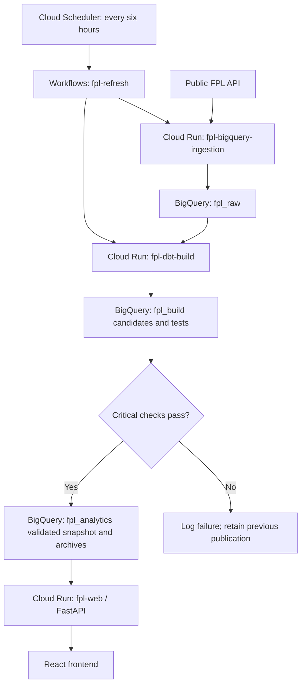

# FPL Optimiser · Touchline

A Fantasy Premier League recommendation app for comparing players, finding
affordable replacements, and building a legal squad around experimental five-gameweek points projections.

**[Open the public app](https://fpl-web-381011398272.us-central1.run.app)**

## What the app does

- Imports a public FPL team's latest published gameweek squad.
- Lets you correct the squad, bank and selling prices before analysis.
- Finds same-position points upgrades and budget-saving replacements, including bank-funded moves.
- Builds an ideal 15-player squad or improves an imported squad within an immediate
  transfer limit.
- Shows availability news, upcoming fixtures, points components and recent
  completed-gameweek points, minutes, starts and xG/xA rates when available.
- Offers a five-gameweek points plan with weekly starting XIs, captains,
  vice-captains, bench order, rotation and current-squad comparisons.
- Supports optional minutes assumptions and flags expensive benches, uncertain
  playing time, shared club exposure and incomplete or stale data.

Imports use public deadline snapshots, not authenticated access to your FPL
account. Exact selling prices cannot be recovered from the public API, so imported
prices are marked as estimates. Squad edits stay in the current browser session;
reloading the page resets them. The app never makes transfers in FPL.

## How recommendations work

### Points-only selection

All recommendation features use the existing experimental points model. There is
no viability score, percentile ranking, score-based eligibility or legacy objective.
Historical measurements remain available as context.

The optimiser chooses one legal 15-player squad and five weekly XIs/captains.
It maximises XI points plus one captain bonus per week, then formation-aware
reserve cover, fewer transfers and lower expenditure. Both ideal-squad and
improve-my-squad modes use this objective. Constraints remain 2 GK / 5 DEF / 5 MID /
3 FWD, maximum three per club, unique players, budget and the immediate transfer cap.
Ideal mode defaults to £100m. Transfer mode uses the bank and entered selling prices.
Money is represented as integer tenths of a million.

The solver has a ten-second total budget. `OPTIMAL` proves the integer primary
objective; `FEASIBLE` is a legal result without a proof of optimality. Secondary
tie-breaks run only after the preceding objective is proved optimal, and unfinished
tie-breaks are flagged. Objective comparisons round each player's GW points to
0.001, while the published projection components retain their original precision.

### Individual replacements

For every affordable, same-position, non-owned player that preserves club limits,
the engine recalculates the fixed squad's best weekly XIs and captains. Affordability
is outgoing selling price plus bank. It evaluates all eligible candidates before
returning up to five candidates in each group:

- **Points improvements:** positive five-week XI-plus-captain gain, ranked by gain,
  tested coverage, savings and player ID. A cheaper player or a bank-funded upgrade
  can qualify; individual five-week points alone do not determine squad benefit.
- **Budget savings:** a strictly cheaper swap with no loss in any weekly XI/captain
  total or the tested single/double-absence coverage counts. Ranked by savings,
  coverage and player ID.

Results show weekly impact, planned starts, coverage changes and savings/bank used.
Applying a suggestion changes only your local squad/bank and recalculates analysis.
Each suggestion is independent; gains from several suggestions cannot be added.
Baseline and candidates use the same horizon and minutes assumptions.

### Experimental points and five-week cover

Projections use completed, data-checked fixture history, with recent five-GW
observations weighted more heavily and positional smoothing for small samples.
Estimated appearances and minutes feed explainable appearance, goal, assist,
clean-sheet, save, defensive-contribution, bonus and deduction components.
Opponent scoring/conceding rates and venue adjust fixture estimates.

The horizon is the next five actionable **gameweek deadlines**, with fewer near
season end. Double fixtures are summed; assigned blanks score zero; unassigned
fixtures are flagged and excluded. A passed first deadline blocks planning until
refresh. New players marked injured, suspended, unavailable or 0% require explicit minutes
assumptions for every assigned week. Owned unavailable players can remain with zero
assumed minutes in unresolved weeks; explicit overrides take precedence and the
conservative assumption is labelled. Later
recovery dates are not inferred.

Minutes overrides are deterministic 0–90 minutes **per fixture**, including each
fixture in a double. The 60-minute threshold changes appearance and clean-sheet
eligibility. Overrides affect only the request, not stored data.

One squad is selected for the whole horizon, with manual lineup changes before
each deadline. Every XI has one goalkeeper, at least three defenders, two
midfielders and one forward. Captain and vice-captain choices, bench order,
weekly reserve spend and planned starts are shown. Formation-aware single/double
absence stress tests assess cover using an 80% estimated reserve-appearance
threshold; these counts are not calibrated confidence levels.

**Limitations:** the points model is experimental and uncalibrated. Headline totals
exclude autosubs and vice-captain fallback. No future transfer schedule, points
hits, chips or machine learning are modelled. There is no hard bench-spend cap.
See [projection methodology and forward evaluation](docs/POINTS_PLANNER.md) for
coefficients, assumptions and evaluation commands.

## Technology and production infrastructure

| Layer | Technology / responsibility |
| --- | --- |
| Frontend | React, TypeScript and Vite; responsive squad, comparison and planner UI |
| Backend | Python 3.12, FastAPI and Pydantic; validation, public FPL imports and API responses |
| Optimisation | OR-Tools CP-SAT; budget, squad, transfer and weekly-lineup constraints |
| Ingestion | Python `requests` and `google-cloud-bigquery`; FPL bootstrap, fixtures and `element-summary/{player_id}/` history |
| Modelling | dbt Core, BigQuery adapter and dbt-utils; staging/intermediate views, marts, generic/custom SQL and unit tests |
| Execution | Separate Cloud Run ingestion/dbt jobs and a Cloud Run web service |
| Scheduling | Cloud Scheduler invokes Google Cloud Workflows; lock-aware sequential refresh |
| Build / operations | Docker, Cloud Build, Artifact Registry, service-account IAM and Cloud Logging |
| Testing / local analysis | pytest, DuckDB/sqlglot SQL regressions and Playwright desktop/mobile tests |

Project: `fpl-optimizer-511321`. Cloud Run, Workflows and Artifact Registry use
`us-central1`; BigQuery datasets use the `US` multi-region.



### Environments and storage

| Purpose | Production | Development / testing |
| --- | --- | --- |
| API inputs, fixture history, checkpoints, manifests and lock | `fpl_raw` | `fpl_raw_localtest` |
| Candidate dbt models and validation | `fpl_build` | `fpl_build_localtest` |
| Serving snapshot and versioned projection archives | `fpl_analytics` | `fpl_analytics_localtest` |

The development datasets are actively used, not disposable production duplicates.
The unrelated sample dataset `fpl_analytics_raw` was removed and sample seeds are
disabled. Production raw API tables, persistent history/control tables and
published/archive copies have no expiration. Production build objects have a
seven-day default; development catalog/build objects also have limited retention.

### Refresh, publication and serving

Scheduler `FPL-bigquery-ingestion` uses cron `0 */6 * * *` in `America/Vancouver`.
Workflow `fpl-refresh` acquires a lock, completes ingestion before dbt, runs source
freshness and critical model/tests, then publishes validated recommendation data.
The dbt publisher archives candidates and keeps the previous serving snapshot
before atomically replacing the serving table. Ingestion/build failures retain the lock for diagnosis; an
operator must verify jobs are idle before recovery.

Bootstrap and fixtures refresh together. History requests target new players,
team changes and finished/changed fixtures, with daily recent-two-completed-GW
checks and weekly full reconciliation. Requests use bounded concurrency/retries;
BigQuery merges use `(season, player_id, fixture_id)` to apply corrections without
duplicating records. Unchanged runs can update the collection heartbeat without
rebuilding rankings; expired projection horizons force a rebuild.

The points-only reader queries `fpl_analytics.mart_recommendation_snapshot` exclusively.
Its identity has BigQuery Job User and table-level read access, without raw/build
dataset grants. It serves UI/API on one origin, caches the dataset for five minutes
per process and gzip compresses responses. API contract version 2 uses a versioned
dataset token; missing/obsolete request contracts and stale dataset versions receive
HTTP 409 with a reload instruction. Backend cache-refresh failures return an error;
pipeline failures leave the last validated publication in place.

Cloud Run is configured for 1 CPU, 1 GiB, concurrency 4, zero minimum instances,
three maximum instances and a 120-second request timeout. The points-only reader
can temporarily read the old snapshot timestamp during coordinated migration; it
never reads the legacy evaluation mart or exposes retired score fields.


## API

| Route | Purpose |
| --- | --- |
| `GET /api/health` | Process health; does not check BigQuery |
| `GET /api/players` | Versioned catalog, historical context and projection data; checks data access |
| `GET /api/teams/{team_id}` | Import a public published squad with estimated selling prices |
| `POST /api/replacements` | Independent points upgrades and budget-saving swaps |
| `POST /api/optimize` | Ideal/transfer optimisation with the selected objective |

POST requests include `contract_version: 2` and the current `dataset_version`.
Replacement and optimisation requests both support `minutes_overrides`.

FastAPI's interactive contract is available at `/docs`. Credentials stay on the
backend; browser requests never access BigQuery directly.

## Run locally

Use Python 3.12, Node 22+ and Application Default Credentials with the required
BigQuery permissions. Serving needs Job User and read access to the development
serving snapshot; refreshing needs write/provisioning access to the development
datasets and access to the existing production catalog schemas.

```sh
python3.12 -m venv .venv-web
.venv-web/bin/python -m pip install -r backend/requirements-dev.txt
gcloud auth application-default login
npm --prefix frontend ci
npm --prefix frontend run build
bash scripts/serve_local.sh
```

Open `http://127.0.0.1:8000`. The wrapper serves the built UI and API against the
published `_localtest` snapshot by default. It does not refresh data or deploy
anything. If the development snapshot is absent or stale, run the refresh below
first. For Vite development and configuration details, see the
[frontend/local guide](deploy/frontend/README.md).

To refresh real development data, activate a **separate Python 3.12 dbt
environment**, then run:

```sh
python -m pip install -r deploy/dbt-build/requirements.txt -r tests/dbt/requirements.txt
dbt deps --project-dir dbt/fpl_optimizer --profiles-dir deploy/dbt-build
python scripts/local_refresh.py
```

The refresh wrapper requires three distinct `_localtest` datasets and runs
ingestion, dbt checks and publication. Use explicit environments/profiles for
manual dbt commands; do not assume a target named `dev` writes to development.

`main.py`, `fixtures.py`, notebooks and `scripts/experimental/` provide a separate
local DuckDB/analysis path. They are not used by the deployed app, and cloud
refreshes do not update `data/fpl.duckdb`.

## Validate changes

```sh
.venv-web/bin/python -m pytest backend/tests -q
# From the separate dbt environment described above:
python -m pytest tests/ingestion tests/dbt -q
npm --prefix frontend run build
npm --prefix frontend test
```

Playwright tests start deterministic preview servers on ports 8002/5174 and do
not access production BigQuery. Install its Chromium browser once with
`cd frontend && npx playwright install chromium`, or set
`PLAYWRIGHT_CHROMIUM_EXECUTABLE_PATH` to an installed Chrome executable.
Documentation-only edits need link/consistency and whitespace checks rather than
cloud executions or the entire application test suite.

## Deployment, recovery and maintenance

Deployments are explicit operator actions. Use the existing workflow for cloud
refreshes rather than executing its ingestion/dbt jobs independently. Web builds
use an allowlisted context, immutable image tags and private-first smoke tests
before public access is granted.

- [Ingestion setup and deployment](deploy/bigquery-ingestion/README.md)
- [dbt build and publication](deploy/dbt-build/README.md)
- [Workflow rollout, scheduling and recovery](deploy/fpl-refresh/README.md)
- [Web deployment and local configuration](deploy/frontend/README.md)
- [Models and data-quality semantics](dbt/fpl_optimizer/README.md)
- [Points methodology and evaluation](docs/POINTS_PLANNER.md)
- [Dated production verification and recovery assets](deploy/fpl-refresh/PRODUCTION_VALIDATION.md)

Retired warehouse tables and historical archives are preserved for rollback; active
dbt builds no longer calculate or publish legacy scores.

Keep this README current in the same change whenever functionality,
infrastructure, configuration or recommendation logic changes. Document verified
production separately from code that is implemented but not deployed. Keep
image tags, execution IDs, historical test counts and incident details in dated
deployment records. See [repository documentation instructions](AGENTS.md).
